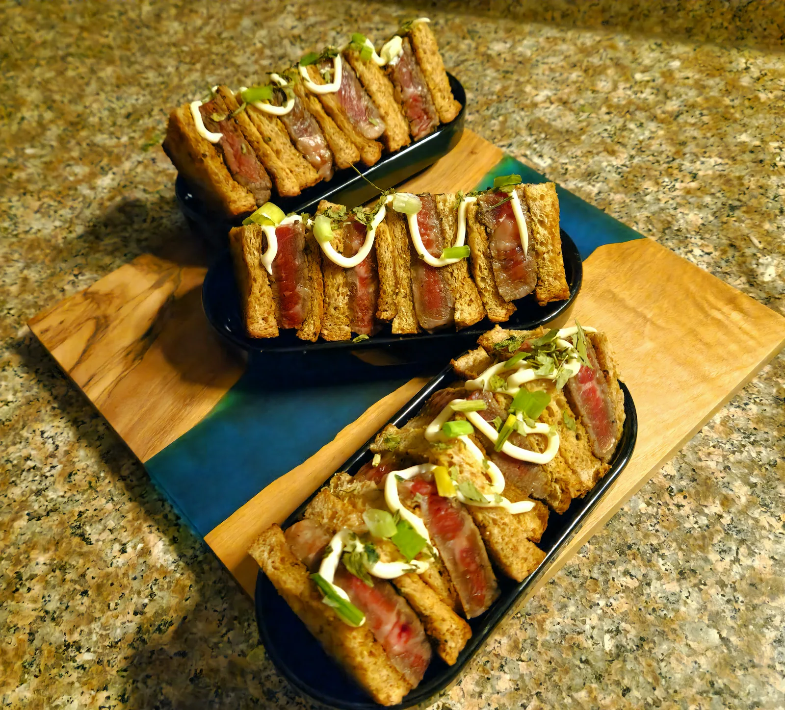
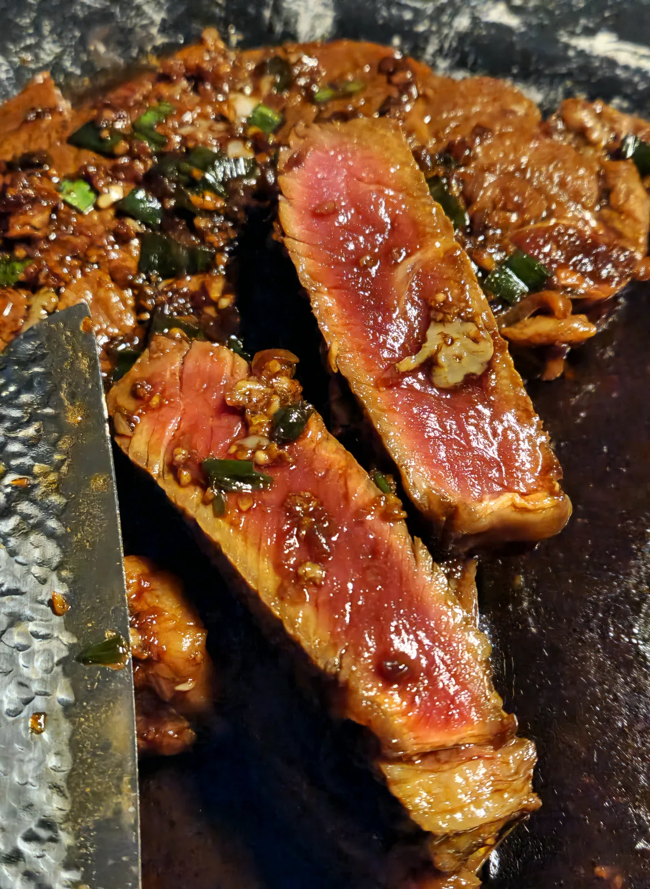
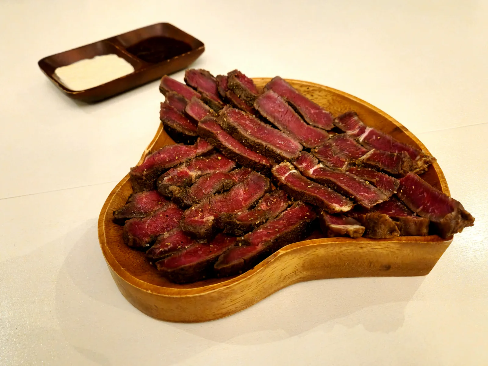
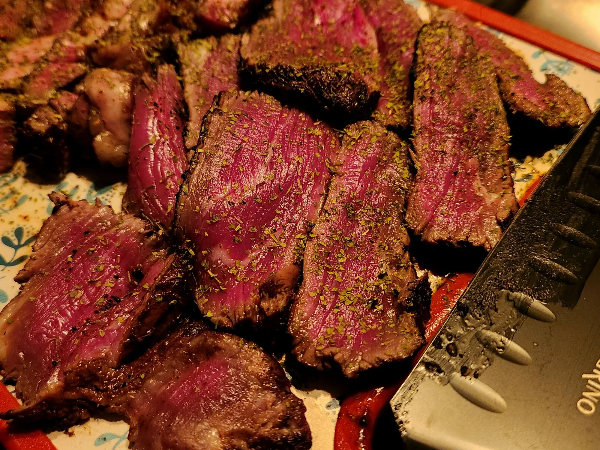
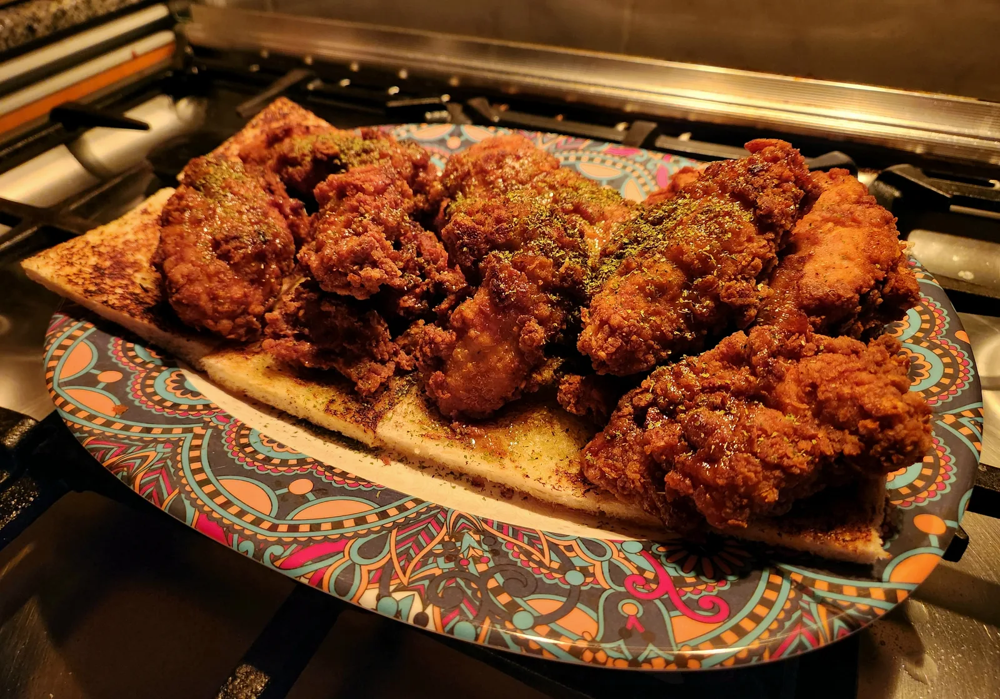
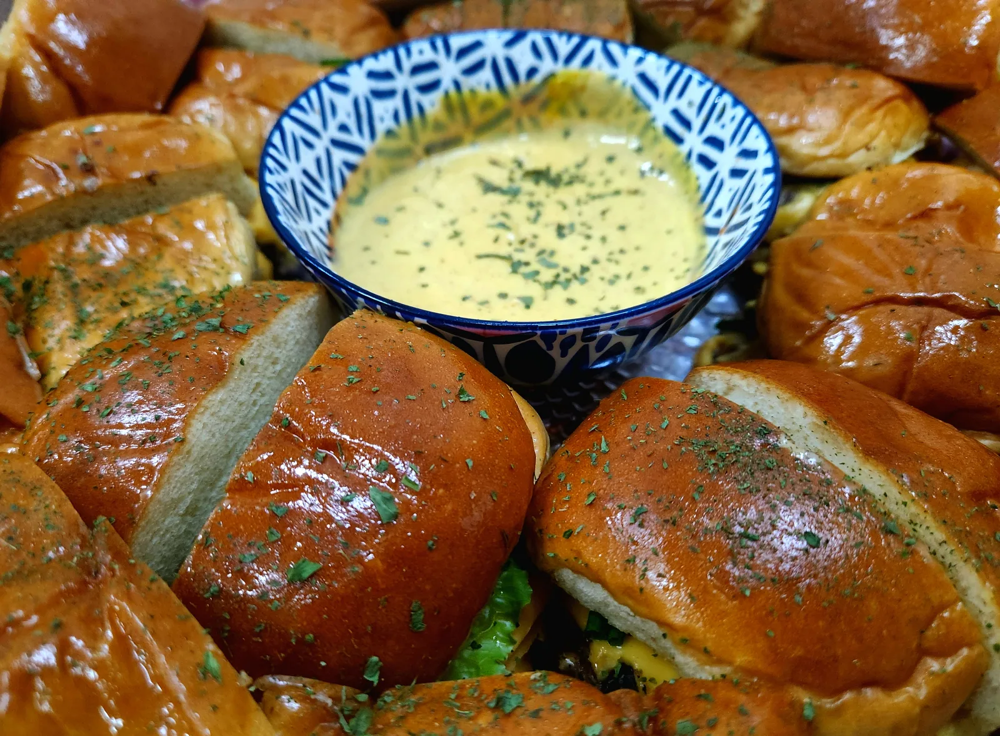

i genuinely believe cooking is an essential life skill. like, something everyone should know how to do at the bare minimum, whether you're into food or not.

i'll preface this by saying i cook weekly, and i've been cooking for almost my whole life, ever since i started trying as a kid. so this isn't coming out of nowhere, it's been a part of my life for a really long time.

but i want to be clear about what i mean when i say cooking, because i think people hear that word and picture very different things.

i don't mean being a Michelin star chef. you don't need to know the intricacies of how everything works, or the science behind every single thing happening in the pan, or how to plate something with tweezers. that's a whole other level and good for the people who are into it, but that's not what i'm talking about here.

and i also don't mean microwaving something. i don't mean throwing something frozen in the air fryer either. that's fine sometimes, i get it, but i wouldn't call that cooking.

i mean actually cooking. buying raw ingredients, doing something with them yourself, and ending up with a meal you made. that's the stuff i think everyone should know.

so here's why i think it's so important.

## it connects you to your food

the first reason is that cooking is a way to connect to your food.

when you cook something yourself, you get to say you ate something that you made. you picked the ingredients, you seasoned it, you watched it cook and you decided when it was done, so by the time it's on your plate it actually feels like yours.

and that's something to be proud of. it's a work of art in a sense. instead of saying "hey, there's this piece of chicken i had at KFC", you can make a piece of chicken yourself, and make it look good, and maybe show it off or share it with someone. or you just end up with more leftovers, because of pricing, which brings me to my next point.

---

## it's so much cheaper

cooking is much, much, much cheaper than ordering food. i can't stress that enough.

especially with certain dishes, the ones with rice or noodles or chicken, and even beef sometimes. if you know how to make a dish and you've bought the ingredients, you probably already have them in bulk for around the same price you'd pay for one meal at a fast food place.

for example, fourteen pieces of chicken, or even a whole chicken, might be around ten dollars. but ten dollars is also the price of just a few pieces from a chicken place. so you're paying about the same, except at home the rest of those pieces get made into more and more things, or into one much bigger meal. plus they're raw, so you get to do whatever you want with them. fry them, grill them, marinate them, throw them in a stew, whatever you're feeling.

and then there's leftovers. when you cook you get to have your own leftovers, so you can spare some for the next day, meal plan a bit, separate things into portions and keep them for later in the week.

so yeah, cooking is way more cost effective than ordering. if you're a student or tight on money you'll notice the difference pretty quickly.

## you make it exactly how you like it

but on a more personal note, you get to make food however you want to make it. however you want to experience it.

you like your stuff a little more spicy? add more. you like your noodles a little more stiff? take them out earlier. you like your bread buttered and toasted with garlic? go for it, do whatever you want. there's nobody to ask and no menu telling you what you can or can't have.

my motto for cooking is i cook food the way i like it.

so for the most part, unless someone has a very specific request or i know someone doesn't like their food a certain way, i cook food the way i like eating my food. and to me that makes cooking so much more enjoyable, because i'm not just making something to get it over with, i'm making the exact thing i actually want to eat.

---

## it's art you get to eat

that kind of leads me to my next point, which is that cooking feels like you're almost becoming one with the consumption of it all.

like i said before, cooking is an art of one kind. but it's a very unique one, because it's the kind that's meant to be eaten and never seen again. once you eat something, it's not physically there in the same way anymore. whatever you made is done for at that point, and you're the only one who got to have it exactly like that.

so when you cook for yourself and you finish it, that's an experience you made for yourself from start to finish, and you get to be pretty proud of that, even if nobody else was there to see it.

## it's how you show people you care

and then there's cooking for other people, which is honestly one of my favourite parts.

cooking for people is a massive way to show gratitude and effort and care and compassion. whether it's your friends or your family or someone you love or someone you're trying to get closer to, or even just your neighbours, cooking for them is such a big way to show it.

it takes time and effort, and you have to think about what they'd like and how they'd want it, and when you finally put the plate in front of them they can tell you did all of that for them. it's wonderful. and it doesn't need to be anything crazy either, even something simple made for someone means a lot.

---

## start small

now, if all of this sounds like a lot, you can start small. you can always start small.

it's okay to follow a recipe. it's okay to just learn how to make eggs or fry some rice. those are really easy things to do, and you can do them with very little equipment and not many ingredients.

for fried rice you really just need some cooked rice (day old rice works best), a bit of oil, some soy sauce, and an egg if you have one. that's about it.

for eggs, you need eggs. that's it. you can hard boil them in water if you'd like, or soft boil them, which is what i prefer.

and once you've got one or two easy things down you'll want to try something a little harder, and then something harder after that, and before you know it you're making stuff you never thought you'd be able to make.

look, for the most part everything you see in these pictures is self taught. it's all me fucking around and finding out. it's me trying to understand how food works and going "oh, what if i tried this with this?"

like maple syrup marinated, candied steak. turned out incredible. same thing with dousing chicken in that maple syrup. and on top of that, these little blue cheese beef sliders were wonderful too. i just tried stuff and kept trying stuff.

there are so many different ways to try so many different things. the sky, or sometimes your allergies, really is the limit.

---

## so go cook something

so this is my call to action. this is what i'm imploring you to do.

cooking isn't just an essential skill for life, it's part of what makes life actually worth living. your family cooking for you, someone you love cooking for you, or you cooking for someone else and getting to see them enjoy it. there's so much joy and care in that, and you get to be a part of it every time you cook.

so go make something. make it the way you like it, and then make it for someone you love :)
