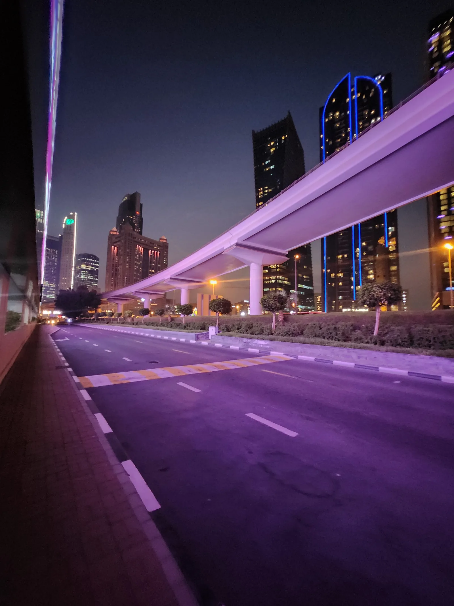

hey, i'm just trying something new.

i've always wanted to have a blog, and honestly i've tried a lot in the past. Tumblr, Blogger, Instagram, i even had an audio blog at some point. but it always ended up being too much hassle, and i always felt this pressure to make everything super high quality. i'd either make it way too over the top or way too laid back, and i never ended up liking how it turned out.

so this time i'm trying my hand at a little Neocities style website, and i'm hoping i actually commit to this one.

here's what i'll be posting:

- day-to-day things i do
- stories that happen to me
- thoughts here and there
- a lot of my cooking (if i end up doing more of that)
- things from the past, things i'm thinking about right now, and things that are about to happen

basically just personal ponderings and so on. it's pretty laid back, but this is where you can pick at my mind, if you'd like.

so for whoever's reading, i hope you find this even the slightest bit interesting. and if i've made you smile, then i consider that a success <3

until my next post (which should be out soon), i'll see you then :)
