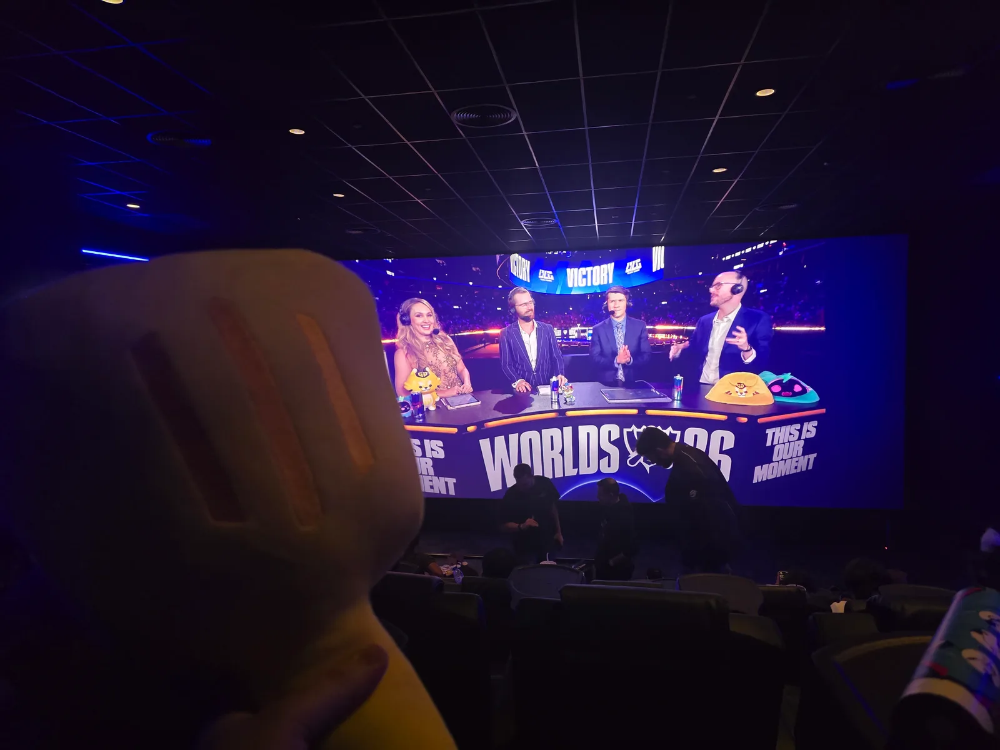
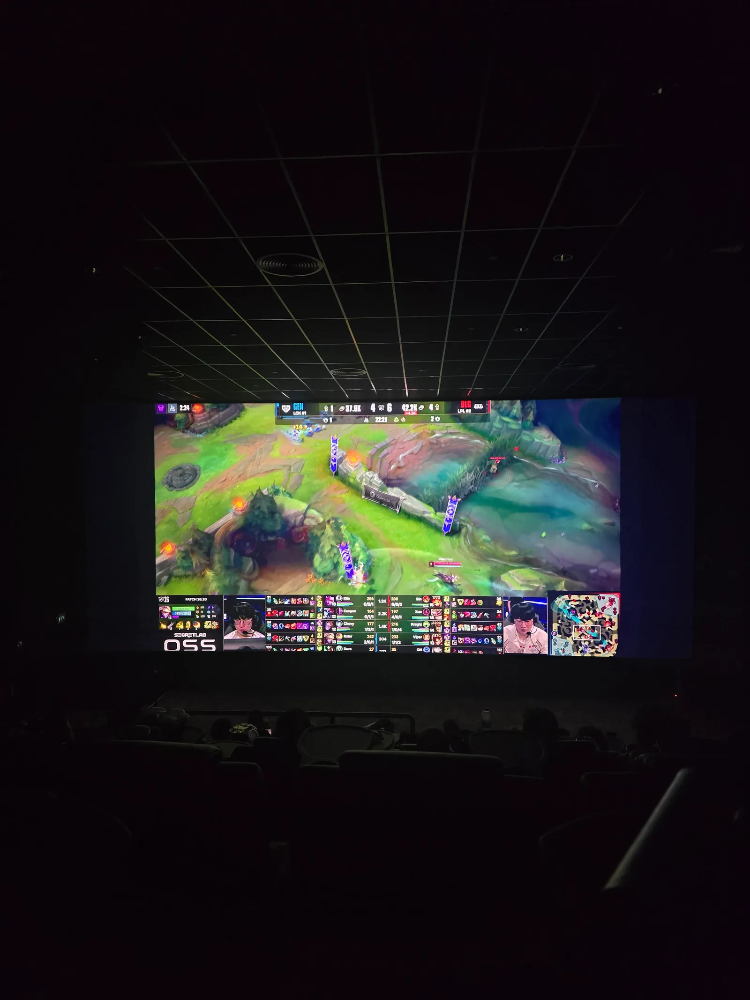
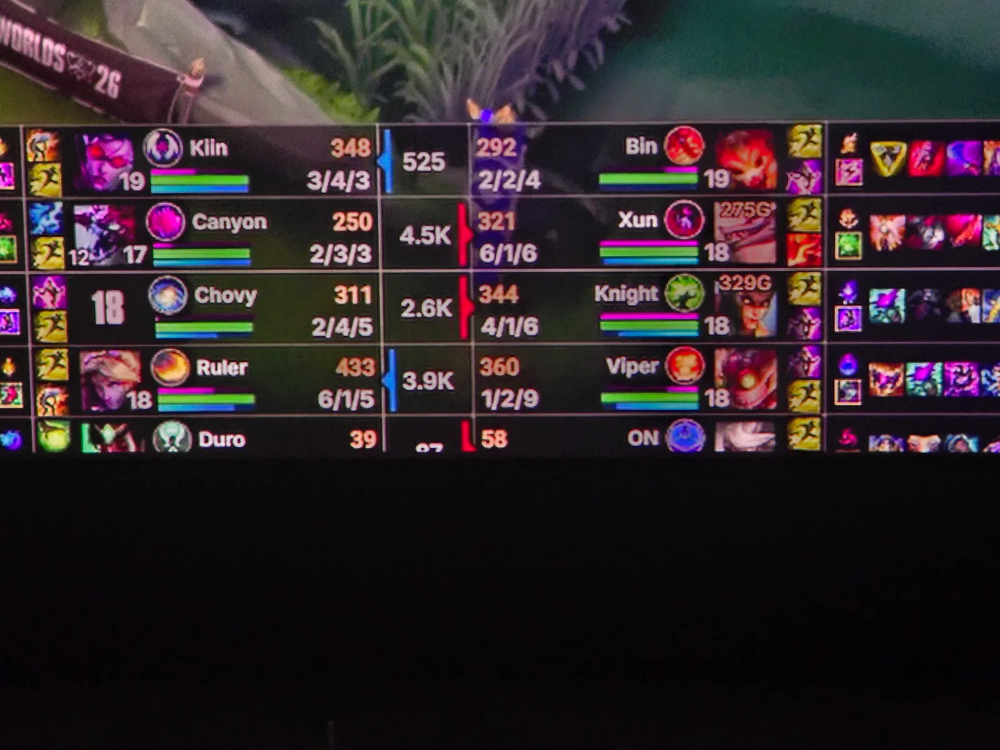
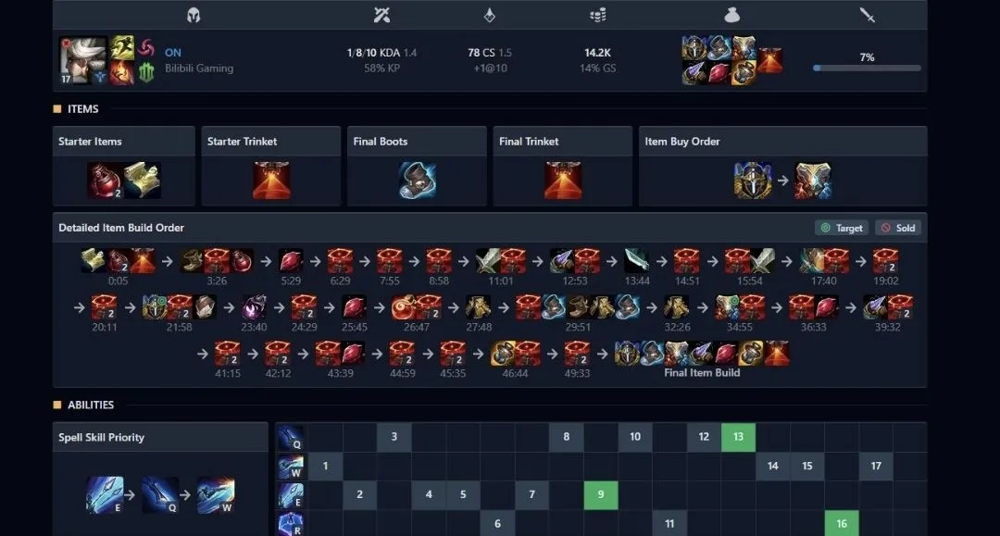

i've been watching Worlds since 2014 and i've loved pretty much every bit of it. this year i was worried it was going to be underwhelming, but the final turned out to be a lot more than that. parts of it were some of the best i've seen in a very long time, and parts of it were a little disappointing. so here are my thoughts on Gen.G vs BLG :)

## watching it in the cinema

i watched the final in a cinema, which was cool in theory. in practice the screening was pretty horrible. it was streamed off some guy's Mac with a janky setup, and the bottom of the screen was constantly cut off.

i never even got to see how many deaths ON ended up with.

still, i'm really grateful i got to be there for it, especially for game 2.

## no stake, but a preference

i had no real personal stake in this one. i'm a KT fan, and this year i was a neutral. i wanted to see a new champion, so i was glad the final was Gen.G vs BLG, since it meant we were guaranteed a new Worlds winner, technically. i don't count the SSG and SSW wins as Gen.G wins. same org on paper, but not really the same functionally, it's only the ownership that carried over.

i'd have been slightly happier if Gen.G won, because i have friends who work there. with the US flights getting grounded, some of them weren't able to make it to the finals, so for their sake it would've been nice to see them win.

but i would've been happy with BLG winning too. we'd finally get a non-Korean mid laner lifting the trophy for the first time since 2012, and the first non-Korean team since 2021. a lot of firsts in a very long time.

## what i expected

Gen.G looked like the favorites. they were basically undefeated going in, they'd only dropped one game, and that was to LYON. pound for pound, player for player, they weren't completely equal with BLG, but there was a lot in the matchup where you could say okay, this is tough either way. my prediction was Gen.G winning 3-2, and secretly i hoped BLG would take it.

## games 1 and 2

game 1 was very promising, and game 1 and game 2 were some of the best games i've seen at Worlds. game 2 especially. i honestly think it's one of the best games of League of Legends i've ever seen, not just at Worlds and not just in a final. you never knew when it was going to end. it broke the record for the longest game at Worlds 2026, and for good reason.

this is the kind of League we want to see. two teams that seem matched in skill, and you have no idea who's going to take it all. that's what makes it so good, it's not predictable. even if they take Elder, even if they get Baron, even if they're at the Nexus towers, it doesn't matter. they persevered and kept pushing and pushing until it finally broke through. as a neutral i can't even put into words how fun that was to watch.

## why BLG won

i'm not going to go game by game, i think that would be too much to break down. but for the most part, BLG won in the draft. their coach got them through it. Gen.G drafted in a way that planned for a very specific outcome and a very specific play, while BLG adapted. their champion pool was huge and they had some very particular flex picks that worked in their favor, like ON on Camille support.

and Gen.G just got outclassed, apart from the one game they won. Kiin, Canyon, Chovy and Duro all tried everything they could, but it felt like they were playing like they were still in the LCK, like they were still playing teams that execute a specific plan against a specific plan. the LPL isn't like that. there's a reason BLG took down LCK team after LCK team and took out the entire region. their style is very adaptable and very aggressive, it's very much "we don't care what you do, we're going to take you out no matter what". and they showed that.

a lot of it also comes down to Chovy, who i'll get to in the ratings. not that he played badly, but under pressure he wasn't able to be what he needed to be. he had some great games, but for the most part it just wasn't enough.

## player ratings

these are overall, across the four games, and all ratings are out of 10. my scale is that 5 is a baseline average, 6 is a little better than average, and 4 is a little below average. you can figure out the rest from there.

### Gen.G

- Kiin: 5.5/10. he was really good in some cases and his positioning was great, but he faltered when his team really needed him.
- Canyon: 6/10. he was perplexing at times, but he still put his all into it. he put his body on the line with that Cho'Gath ult smite and got everything he could out of it, and i applaud that.
- Chovy: 3.5/10. mechanically he's at the level of one of the best LCK players, and maybe even at his level in these games. but when it comes to decisions, positioning and keeping his head so things don't flounder away, he was completely off. i think he was the biggest underperformer on the team. he's someone you'd have to rely on as a leader, and to put it lightly, he wasn't reliable. i just don't think he has what it takes for Worlds, and if Gen.G want to win this, they might genuinely have to get rid of Chovy. i'm not saying Chovy himself couldn't win Worlds, i just think he needs a team around him that doesn't rely on him to that degree and doesn't make him the centerpiece. mentally i don't think he can take all that pressure. but again, that's my personal opinion, i never played at this level, this is just how i see it.
- Ruler: 8/10. by far the best player on Gen.G every single game, and even better than most of the BLG players while BLG was winning. he was the only one with a constant, consistent gold lead, and he completely golfed the other team. i've been telling everyone Viper is the best ADC in the world, no question, but Ruler diffed him and gapped him. it was astounding. if only he'd had a team built around him, or one that supported him the way Faker's team supported him, where Faker was drooping a little bit but there was carry around him, there was Zeus around him, and they picked up the slack and carried together.
- Duro: 5/10. a little invisible at times. he didn't underperform and he didn't overperform, he did his job, and there were very few cases where he got caught out.

### BLG

- Bin: 8.5/10. he played like crazy. in my opinion he wasn't the best on the team, but he was still really good, and those Jax plays were insane. the way he maneuvers his Flash E is unparalleled. he's undeniably the best Jax i've seen in history, there's not a single person i've seen play Jax better, and it's a testament to his mastery of that champion. if he doesn't pick Jax for his Worlds winner skin, i don't know what to say. immaculate.
- Xun: 8/10. really clutch in the moments where it mattered and counted. he got some really good smites off, and he played to the level he needed to at Worlds. i think there could have been more, but he performed very, very well.
- Knight: 8.5/10. he got Finals MVP, but in my opinion he didn't deserve it. he completely diffed Chovy, game after game. Gen.G even let Chovy take Orianna against him, even though Knight is really good on Orianna himself, and it's like he showed him that even when you take my Orianna, i can still play better than you, i can still outflash you, i can still Protobelt out of everything. some people say he got MVP because he diffed Chovy, and i don't think that was the case. to win against Chovy is to win the mental game. i feel like Knight and Chovy are somewhat parallel in skill, even though i believe Knight is better. at Worlds that's hard to quantify sometimes, but the mental game is unparalleled.
- Viper: 7/10. i had very high hopes for him coming in. he was a useful team player, did his job very well and got those clutch Ziggs ults, but he left a little to be desired, especially after being gapped so hard by Ruler every time. my opinion of Viper as the best ADC in the world might be dwindling a bit because of how insanely Ruler played. he's somewhere between amazing and average. he didn't bring his team down at all and there was never a moment where i thought he was going to make them lose, but he didn't make them win it either.
- ON: 9/10. in my opinion he had the best performance of all of them, even after dying eight times on Camille. he was the best player in every game except maybe the first one, where i'd say Ruler was. his Alistar was insane, the casters even called it the ONsec (like an Insec, but it's ON doing it on Alistar). the way he canceled the Ambessa again and again, the way he demolished every hope Gen.G had of killing him, he almost never died, which is the opposite of his Camille game. his Camille was insane too, and his Neeko ults were absolutely crazy. he was immaculate, and the only reason it's not higher than 9 is his first game. i think ON should have gotten the MVP.

## closing thoughts

as a whole it didn't feel underwhelming, but it could have been so much more if Gen.G had shown up. game 1 was very promising, game 2 was one of the best games of League i've watched in my entire life, after watching esports for something like twelve years. there was a little bit of a fight in games 3 and 4, but nowhere near enough. sadly that's just how it turned out.

but i'm very happy i got to see the final the way it was. i'm very happy to see a new non-Korean mid laner win. the last time was Taipei Assassins (TPA) back in 2012, way back in season two, and every mid laner since has been Korean, which is crazy. it's nice to see a new Worlds winner, and it's nice to see Bin win and actually get his team all the way to the top. i'm glad all their hard work paid off. they're so aggressive and so amazing at what they do. spectacular, wonderful, immaculate, incredible. <3
